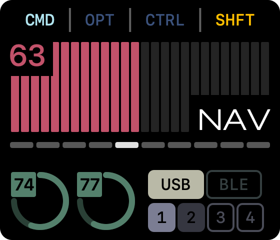
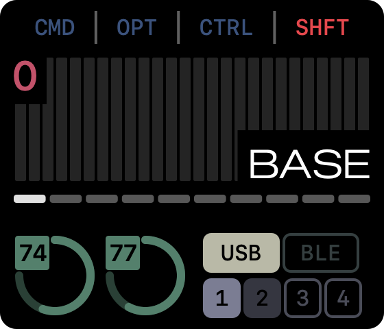
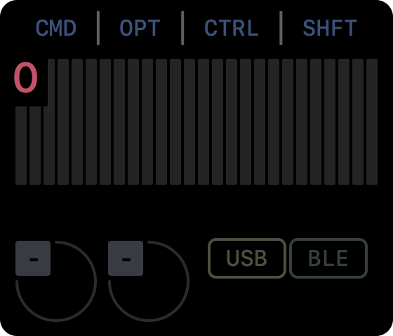
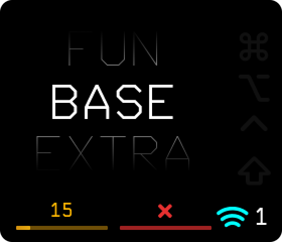
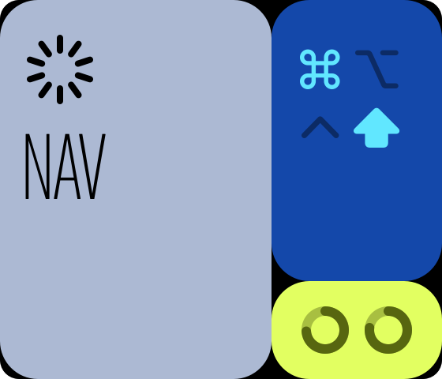
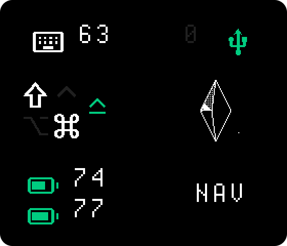
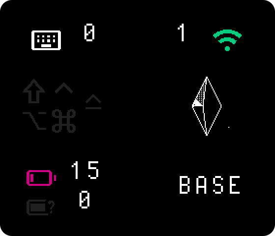
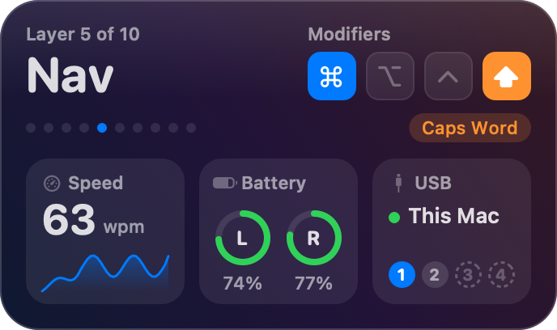

# KeyBeacon

**English** · [中文](#zh) · [**Website** ↗](https://ykiewang.github.io/keybeacon/)

<a id="en"></a>

**KeyBeacon** shows your keyboard's live internal state — the **active layer** and the **held
modifier keys** — in a small desktop app, over Bluetooth LE. It works with any keyboard that
implements the open **KeyBeacon Protocol (KBP)**, not just one brand or model.

> **This fork** ([eg0n/keybeacon](https://github.com/eg0n/keybeacon), branch `feat/usb-hid`) adds:
> KBP over **USB**, for a keyboard or dongle plugged into the Mac; **KBP 1.3** (WPM, layer count,
> Caps Word, Caps Lock, empty profiles, dongle topology); and pluggable **status screens**, starting
> with the Prospector dongle's Operator screen. Its firmware is
> [eg0n/zmk-keybeacon](https://github.com/eg0n/zmk-keybeacon/tree/feat/dongle-usb), branch
> `feat/dongle-usb`. See [KBP 1.3 and USB](#kbp-13-and-usb-this-fork).

## Screenshots

The floating panel shows your keyboard's live state — active layer, held modifiers,
connectivity, and per-half battery — and updates as you type. A **per-link host
indicator** (new in KBP 1.2) tells *this* computer whether the keyboard is typing
here (green ●), is active on another paired computer (orange ◐), or has dropped its
link to this host (grey ○).

### Full display mode

| In use on **this** computer | Active on **another** computer | Link to this host down |
|:---:|:---:|:---:|
|  |  |  |

### Compact display mode

The same state folded into one menu-bar-width strip — layer · modifiers · host ·
profile · per-half battery · output:

| Host state | |
|:---|:---|
| **In use here** — green `● P1` |  |
| **Active elsewhere** — orange `◐ P2` |  |
| **Link down** — grey `○ P4` |  |

### Prospector screens (this fork)

The [Prospector](https://github.com/carrefinho/prospector-zmk-module) dongle's status screens,
redrawn at their 280×240 size from KBP data: carrefinho's **Operator**, **Classic**, **Radii** and
**Field**, and the **Crystal** layout from [our fork](https://github.com/eg0n/prospector-zmk-module).
Choose one under **Display Mode**; with **On Desktop** the panel sits behind your windows like a
desktop widget. Text and icons use the firmware's own bitmap fonts, glyph for glyph.

#### Operator

| Typing, Caps Word on | Idle, Caps Lock on |
|:---:|:---:|
|  |  |
| **Right half offline, left at 15 %, BLE profile 2** | **Disconnected** |
|  |  |

- **Top**: held modifiers; SHFT turns amber for Caps Word and red for Caps Lock.
- **Meter**: words per minute in 26 bars, with a peak marker; the number top left, the layer name
  bottom right, and one segment per layer below.
- **Rings**: each half's battery, green, amber under 20 %, thin and grey while the half is offline.
- **Bottom right**: the output (USB or BLE) and the BLE profiles, the active one lit, empty ones as
  outlines.

#### Classic, Radii, Field and Crystal

| Typing, Caps Word on | Right half offline, left at 15 %, BLE profile 2 |
|:---:|:---:|
|  |  |
|  |  |
|  |  |
|  |  |

- **Classic**: a layer roller, the modifiers down the right, a battery bar per half (a red cross
  while offline). The roller fills in neighbouring layers as their names come up, since KBP sends
  only the active layer's name.
- **Radii**: a layer wheel and name, the modifiers, and battery rings, in the module's blue theme.
- **Field**: a grid of lines that flow faster and brighter as you type and settle when you stop.
- **Crystal**: WPM, output, a modifier grid with Caps Word (green) and Caps Lock (magenta), the
  turning crystal, batteries and the layer.
- On Classic, Radii and Field the BLE profile (numbered from 0, as on the dongle) shows while BLE
  is the output and for 3 seconds after a change; Caps Lock, which the dongle doesn't show there,
  turns Shift into a red Caps Lock key.

### Glass widget (this fork)

The same data in macOS's own design language: SF Pro and SF Symbols, system colours, light or
dark with the system, on Liquid Glass (macOS 26 and later; a translucent material before). Choose
**Glass Widget** under **Display Mode**.

| Typing, Caps Word on (light) | Typing (dark) |
|:---:|:---:|
|  |  |
| **Caps Lock on (light)** | **Right half offline, BLE profile 2 (dark)** |
|  |  |

- **Top**: the layer, its place in the keymap and a dot per layer; a keycap per modifier, orange
  for Caps Word and red for Caps Lock, with a capsule naming which.
- **Speed**: words per minute and the last 40 seconds as a sparkline.
- **Battery**: a ring per half, orange at 20 % and red at 10 %, empty while the half is offline.
- **Output**: USB or Bluetooth, which computer it is typing to, and the BLE profiles (dashed when
  empty).

The previews show a stand-in for the glass, as offscreen renders can't capture it.

The renderings come from `swift run screen-preview` (see [Build from source](#build-from-source-optional)).
New screens are one file and a registry entry; [CLAUDE.md](CLAUDE.md) explains how.

### Menu bar

Reconnect, switch display mode (including status screens), or change language. The **Panel**
submenu (this fork) gathers the panel's settings: show or hide it; its layer, above windows or on
the desktop behind them; its position, anywhere or pinned to a corner; and a lock that lets clicks
pass through it:


## Why KeyBeacon

Many ZMK keyboards — the Totem among them — have **no screen**. You press a layer key and have no
on-device way to confirm which layer is actually active. The usual answer is to add hardware: a
small OLED/display, extra wiring, extra firmware, extra cost.

KeyBeacon takes the opposite approach. The host your keyboard is already connected to **has** a
screen, so let the software show the state instead of bolting on hardware. The keyboard simply
reports what it knows over its existing BLE link, and the desktop app displays it. **No extra
hardware, no screen, no soldering** — a displayless keyboard gains a display for free.

**Vision**: start with layer + modifiers, but grow into a **general-purpose window into a keyboard's
internal state**. The protocol is versioned and extensible by design, so future versions can surface
more of what the keyboard knows but can't otherwise show — e.g. battery level, active output/profile,
connection status, caps-word/sticky state — for **any** keyboard that speaks KBP, on any OS.

This repository is the **home of three things**:

| Directory | What |
|-----------|------|
| [`app/macos/`](app/macos/) | The macOS app (menu-bar widget + floating status panel). |
| [`app/windows/`](app/windows/) | The Windows app (system tray + floating status panel). |
| [`protocol/`](protocol/) | The authoritative, versioned **KeyBeacon Protocol** standard (KBP). |
| [`conformance/`](conformance/) | The **conformance kit** — guide + checklist + self-test tool for keyboard authors. |

> **Platform status**: macOS and Windows are available now. **Linux is planned for the next
> iteration.** The protocol is OS-neutral by design.

## Interface language

Both apps are bilingual — **中文** and **English**. Pick **Follow System / English / 中文** from the
app menu (macOS menu bar / Windows tray). The whole UI switches immediately with no restart, and the
choice is remembered across launches. "Follow System" tracks the OS locale: `zh-*` → 中文, everything
else → English. Protocol data (layer names, keyboard device names) is shown verbatim and is never
translated.

## Roadmap

Where KeyBeacon is headed — a catalogue of candidate metrics worth surfacing for a screenless
(especially wireless split) keyboard. Each item is a self-contained **KBP MINOR** addition (a new
optional BLE characteristic across **protocol → firmware → app**), so apps on an older protocol
ignore what they don't recognize and keep working. Feasibility assumes ZMK, which is event-driven:
items marked *High* already have firmware events to hook; exact API names are confirmed per item at
spec time. These are candidates, not commitments.

### A. Connectivity & power

> **Status**: ✅ **Shipped in KBP 1.1** — released 2026-10-09. **Per-link host context shipped in KBP 1.2** — released 2026-11-08.
> Specification: [`specs/001-connectivity-power/spec.md`](specs/001-connectivity-power/spec.md)
> and [`specs/005-host-link-profile-awareness/spec.md`](specs/005-host-link-profile-awareness/spec.md);
> firmware module: [`zmk-keybeacon@v1.1.2`](https://github.com/ykiewang/zmk-keybeacon/releases/tag/v1.1.2)
> (KBP 1.1) / [`zmk-keybeacon@v1.2.0`](https://github.com/ykiewang/zmk-keybeacon/releases/tag/v1.2.0) (KBP 1.2)
> ([CHANGELOG](https://github.com/ykiewang/zmk-keybeacon/blob/main/CHANGELOG.md));
> normative wire contract: [`protocol/README.md §14`](protocol/README.md#14-kbp-11-connectivity--power-optional)
> and [`§15`](protocol/README.md#15-kbp-12-per-link-host-context-optional).

| Metric | Status | Why it helps a screenless split | ZMK feasibility | Protocol impact |
|--------|--------|---------------------------------|-----------------|-----------------|
| Host link status | ✅ Shipped (v1.1) | is the keyboard actually connected to the host | High — active-profile connected state + event | KBP 1.1 · AA2 bytes `host_state` + `last_disconnect_reason` |
| Active BLE profile | ✅ Shipped (v1.1) | which profile slot (1–5), and whether it's open for pairing | High — profile index / open state | KBP 1.1 · AA2 bytes `profile_index` + `profile_max_slots` |
| Per-half link status | ✅ Shipped (v1.1) | a split half dropping offline is visible at a glance | High — proxied via `zmk_peripheral_battery_state_changed` + 75 s TTL (ZMK does not expose a central-side split-link API at commit `6b44d33d`) | KBP 1.1 · AA2 `split_flags` bits 0–1 |
| Per-half battery | ✅ Shipped (v1.1) | know which half to charge | High — battery + peripheral-battery events (requires `CONFIG_ZMK_SPLIT_BLE_CENTRAL_BATTERY_LEVEL_FETCHING=y`) | KBP 1.1 · AA3 payload `[0]` / `[1]` |
| Active output | ✅ Shipped (v1.1) | whether keystrokes go to USB or BLE | High — `zmk_endpoints_selected()` + change event | KBP 1.1 · AA2 `output_endpoint` byte |
| Per-link host context | ✅ Shipped (v1.2) | tells *this* computer whether the keyboard is typing here vs active on another host — zero config | High — per-connection READ resolves the asking host's bonded slot ([`specs/005-host-link-profile-awareness`](specs/005-host-link-profile-awareness/spec.md)) | KBP 1.2 · AA4 `local_link_profile` (READ-only, per-connection) |
| Charging status | ⚠️ Protocol-defined; hardware-dependent (corne lacks a charge-detect GPIO, so capability bits 5–6 stay `0`) | whether a half is charging | Low — most boards lack a charge-detect pin | KBP 1.1 · AA2 `charging_flags` bits 0–1 (opt-in via capability bits) |

### B. Input & lock state

> **Status**: Caps Word and Caps Lock ✅ shipped in **KBP 1.3** (this fork); the rest planned.

| Metric | Why it helps a screenless split | ZMK feasibility | Protocol impact |
|--------|---------------------------------|-----------------|-----------------|
| Caps-Word active | ✅ visualize Caps-Word with no indicator LED | Medium — needs a caps-word event in the ZMK tree | KBP 1.3 · AA5 `flags` bit 0 |
| Host lock LEDs | ✅ Caps Lock (Num / Scroll planned), as reported by the host | High — HID indicators + change event | KBP 1.3 · AA5 `flags` bit 1 |
| Full active-layer stack | see every active layer, not just the top one | High — iterate per-layer active state | KBP 1.2 · appended field |
| Sticky / one-shot pending | a pending sticky modifier or layer | Medium — partly already in `mods` | KBP 1.2 · field (partial overlap) |

### C. Typing stats

> **Status**: WPM ✅ shipped in **KBP 1.3** (this fork); the rest planned.

| Metric | Why it helps | ZMK feasibility | Protocol impact |
|--------|--------------|-----------------|-----------------|
| Typing speed (WPM) | ✅ live words-per-minute | High — `CONFIG_ZMK_WPM` | KBP 1.3 · AA5 `wpm` |
| Keystroke / session count | usage over a session | Medium — count keypress events | KBP 1.2 · stats characteristic |
| WPM peak / rolling average | trend over time | Medium — derived from WPM | KBP 1.2 · stats characteristic |

### D. Device health

> **Status**: 📋 Planned — no implementation yet. Order TBD; `RSSI` is lowest priority.

| Metric | Why it helps | ZMK feasibility | Protocol impact |
|--------|--------------|-----------------|-----------------|
| Activity state | tell when a half has gone idle / asleep | High — activity state + event | KBP 1.x · field |
| RGB / backlight state | confirm effect, brightness, on/off after a blind toggle | Medium — underglow / backlight getters + events | KBP 1.x · characteristic |
| Link quality (RSSI) | signal strength of the host or split link | Low — needs HCI; not exposed by default | later |
| Uptime | time since last reset (diagnostics) | High but low value — `k_uptime` | KBP 1.x · field |

## KBP 1.3 and USB (this fork)

KBP 1.3 adds four optional pieces; older apps and keyboards ignore what they don't know. The
normative text is [`protocol/README.md` §16](protocol/README.md#16-kbp-13-activity-open-profiles-dongles-and-usb-optional).

- **Activity characteristic** `AA440AA5-…` (`READ` + `NOTIFY`): `[wpm, layer_count, flags]`.
  `wpm` is 255 when the keyboard computes none; `flags` bit 0 is Caps Word, bit 1 the host's Caps
  Lock LED. Screens use the layer count to draw one mark per layer.
- **Empty profiles**: Connectivity (`AA2`) grows an eighth byte, `open_profiles`, a bit per BLE
  profile with no bonded host.
- **Dongles**: when both halves are peripherals of a dongle, `split_link_flags` bit 0 and Battery
  `[0]` are the left half's and bit 1 and `[1]` the right half's.
- **USB HID**: the same payloads on a vendor-defined HID interface (usage page `0xFFAA`, usage
  `0x44`). Report IDs 1–4 are AA1, AA2, AA3 and AA5; each report body is `[length, payload…]`.
  Input reports arrive on change, feature reports are reads. The app prefers USB while the
  keyboard is plugged in, so a dongle on USB needs no Bluetooth link to the Mac, and no Input
  Monitoring permission.

KBP 1.4 ([`protocol/README.md` §17](protocol/README.md#17-kbp-14-layer-names-optional)) adds a
**Layer Name** characteristic `AA440AA6-…` (`READ` + `WRITE`): write a layer index, read
`[layer_index, layer_count, layer_name]`. On USB it is feature report 5 (Set_Report selects,
Get_Report reads). The app looks up every layer when it connects, so screens that show other
layers, like Classic's roller, have their names from the keymap at once.

On ZMK, the fork of `zmk-keybeacon` implements all of it (see [For keyboard authors](#for-keyboard-authors)).

## Download & run (Windows)

1. Go to the [Releases](https://github.com/ykiewang/keybeacon/releases) page and download
   `KeyBeacon-win-x64-<version>.zip` (or `-win-arm64-` for ARM64 machines). Verify it against the
   matching `.sha256` file if you like.
2. Unzip and run `KeyBeacon.exe`. The build is **self-contained** — no .NET runtime install needed.
3. **First run:** the build is unsigned, so Windows SmartScreen warns. Click **More info** →
   **Run anyway**. If the download was marked blocked: right-click `KeyBeacon.exe` →
   **Properties** → tick **Unblock** → **OK**.
4. The app lives in the **system tray** (no taskbar window) — look for the **K** icon, possibly under
   the `^` overflow arrow. Left-click toggles the floating panel; right-click opens the menu.

Requires Windows 10 (build 19041 / 2004) or Windows 11.

## Download & run (macOS)

> **This fork**: build the app with `./packaging/make-app.sh` (below), or download it from the
> Totem's firmware workflow in [eg0n/miryoku_zmk](https://github.com/eg0n/miryoku_zmk) (the
> `firmware-esb-nrfdongle` artifact holds `BleWidget-<commit>.dmg`). The steps below still apply.

1. Go to the [Releases](https://github.com/ykiewang/keybeacon/releases) page and download the
   latest `BleWidget-<version>.dmg` (or `.zip`).
2. Open the `.dmg` and drag **BleWidget.app** out (or just double-click it from the `.zip`).
3. **First launch (important):** this build is **ad-hoc signed** (not notarized), so macOS
   Gatekeeper blocks it on first open. **Drag BleWidget.app out of the `.dmg`** (to `/Applications`
   or the Desktop) and **eject the disk image first**. Then right-click the app → **Open** → confirm
   once.
4. When prompted, **grant Bluetooth permission**. The app lives in the **menu bar** (no Dock
   icon). Connect a compatible keyboard and its live layer/modifier status appears.

No terminal, no build tools, no source checkout required.

### First launch: Gatekeeper workaround

Notarization requires a paid Apple Developer ID (a pending prerequisite), so releases are currently
**ad-hoc signed** and macOS quarantines the download. After dragging the app out of the `.dmg` and
ejecting the image:

- Right-click the app → **Open** → confirm once.
- Alternatively: **System Settings → Privacy & Security** → scroll to the blocked-app notice →
  click **Open Anyway**.

You only need this the first time. A future notarized release will remove the step entirely.

> **Known limitation this iteration**: the artifact is ad-hoc signed but not notarized, so the
> \"zero-warning, double-click\" goal (spec SC-001/SC-002) and notarization (FR-002) are **not met
> yet** — they are deferred to the signed-release follow-up. Everything else (download, run,
> live status) works today.

## Requirements

- macOS 12 (Monterey) or later.
- A keyboard that implements KBP on its host-link (central) BLE role — see
  [`conformance/`](conformance/).

## Build from source (optional)

```bash
cd app/macos
swift build -c release        # or: swift run BleWidget
swift test                    # pure-logic unit tests (needs Xcode, not just the Command Line Tools)
swift run screen-preview /tmp # renders every status screen in sample states to PNGs
```

Package a distributable bundle locally:

```bash
./packaging/make-app.sh 0.0.0-dev   # → dist/BleWidget.app, .dmg, .zip, .sha256
```

## For keyboard authors

**Running ZMK?** You don't need to implement KBP by hand — use the ready-made
[`zmk-keybeacon`](https://github.com/ykiewang/zmk-keybeacon) Zephyr module. Add it to your
`config/west.yml` (pinned to a release tag) and set `CONFIG_ZMK_KEYBEACON=y` on the central
build — no file copying, no `include()`/`rsource`. The two-step setup is documented in the
module's [GETTING-STARTED.md](https://github.com/ykiewang/zmk-keybeacon/blob/main/GETTING-STARTED.md).

**Want a complete, working example?** [`zmk-config-totem`](https://github.com/ykiewang/zmk-config-totem)
is a full ZMK config that wires KeyBeacon into a split keyboard — flash it to a Totem to use it
directly, or read it to see exactly how the module is plugged in:
[`config/west.yml`](https://github.com/ykiewang/zmk-config-totem/blob/master/config/west.yml) pins
the module to a release tag, and
[`config/boards/shields/totem/totem_left.conf`](https://github.com/ykiewang/zmk-config-totem/blob/master/config/boards/shields/totem/totem_left.conf)
enables it on the central half with the KBP 1.1 / 1.2 sub-options. Its
[readme](https://github.com/ykiewang/zmk-config-totem#keybeacon-layer--modifier-status-over-ble)
walks through the integration.

**Dongle, USB or KBP 1.3?** Use this fork's module,
[eg0n/zmk-keybeacon `feat/dongle-usb`](https://github.com/eg0n/zmk-keybeacon/tree/feat/dongle-usb):
`CONFIG_ZMK_KEYBEACON_SPLIT_DONGLE=y` for a dongle central, `CONFIG_ZMK_KEYBEACON_USB=y` with
`CONFIG_USB_HID_DEVICE_COUNT=2` for USB, and `CONFIG_ZMK_WPM=y` / `CONFIG_ZMK_HID_INDICATORS=y` for
WPM and Caps Lock. Its README has a complete dongle configuration.

**Any other firmware, or implementing from scratch?** Read [`protocol/README.md`](protocol/README.md)
(the standard) and [`conformance/CONFORMANCE.md`](conformance/CONFORMANCE.md) (what to implement),
then run the self-test tool:

```bash
python3 conformance/conformance_tool.py
```

## License

MIT — see [LICENSE](LICENSE). The protocol is intentionally permissively licensed so any keyboard
or app may implement it.

---

<a id="zh"></a>

# KeyBeacon(中文)

[English](#en) · **中文** · [**网站** ↗](https://ykiewang.github.io/keybeacon/)

**KeyBeacon** 在一个小巧的桌面应用里,通过蓝牙 LE 实时显示键盘的内部状态 —— **当前层**与
**按住的修饰键**。它适用于任何实现了开放的 **KeyBeacon 协议(KBP)** 的键盘,而不限某一品牌或型号。

> **本分支**([eg0n/keybeacon](https://github.com/eg0n/keybeacon),分支 `feat/usb-hid`)新增:经
> **USB** 传输 KBP(键盘或接收器插在 Mac 上时);**KBP 1.3**(WPM、层数、Caps Word、Caps Lock、空
> profile、接收器拓扑);以及可插拔的**状态屏**,首个是 Prospector 接收器的 Operator 屏。固件见
> [eg0n/zmk-keybeacon](https://github.com/eg0n/zmk-keybeacon/tree/feat/dongle-usb) 分支
> `feat/dongle-usb`。详见下方「KBP 1.3 与 USB」。

## 界面预览

悬浮面板实时显示键盘状态 —— 当前层、按住的修饰键、连接状态与左右半电量 —— 并随你打字更新。
其中的**每连接主机指示**（KBP 1.2 新增）会告诉*这台*电脑：键盘正在此打字（绿 ●）、在另一台
已配对电脑上活跃（橙 ◐），还是与本机的链路已断开（灰 ○）。

### 完整模式

| 正在**此**电脑使用 | 在**另一台**电脑使用 | 与本机链路断开 |
|:---:|:---:|:---:|
|  |  |  |

### 精简模式

同一状态折叠进一条菜单栏宽度的横条 —— 层 · 修饰键 · 主机 · profile · 左右半电量 · 输出:

| 主机状态 | |
|:---|:---|
| **本机在用** — 绿 `● P1` |  |
| **他机在用** — 橙 `◐ P2` |  |
| **链路断开** — 灰 `○ P4` |  |

### Prospector 屏(本分支)

[Prospector](https://github.com/carrefinho/prospector-zmk-module) 接收器的状态屏,按其 280×240 尺寸用
KBP 数据重绘:carrefinho 的 **Operator**、**Classic**、**Radii**、**Field**,以及
[本分支固件](https://github.com/eg0n/prospector-zmk-module)的 **Crystal**。在**显示模式**中选择;勾选**置于桌面**后面板位于所有窗口之下,像桌面小组件。文字与图标使用固件自带的位图字体,逐字形一致。

#### Operator

| 打字中,Caps Word 开 | 空闲,Caps Lock 开 |
|:---:|:---:|
|  |  |
| **右半离线,左半 15%,BLE profile 2** | **未连接** |
|  |  |

- **顶部**:按住的修饰键;Caps Word 时 SHFT 变琥珀色,Caps Lock 时变红色。
- **条形表**:26 格显示每分钟字数,带峰值标记;左上为数字,右下为层名,下方每层一段。
- **圆环**:每半的电量,绿色,低于 20% 为琥珀色,离线时变细变灰。
- **右下**:输出(USB 或 BLE)与 BLE profile,当前的点亮,空的只画轮廓。

#### Classic、Radii、Field 与 Crystal

| 打字中,Caps Word 开 | 右半离线,左半 15%,BLE profile 2 |
|:---:|:---:|
|  |  |
|  |  |
|  |  |
|  |  |

- **Classic**:层滚轮、右侧一列修饰键、每半一条电量条(离线时为红叉)。KBP 只发送当前层的名字,滚轮会随层名出现逐步补全相邻层。
- **Radii**:层转盘与层名、修饰键、电量圆环,采用模块的蓝色主题。
- **Field**:一格格短线,打字越快流动越快越亮,停下后慢慢平复。
- **Crystal**:WPM、输出、修饰键网格(Caps Word 绿、Caps Lock 品红)、旋转的水晶、电量与层名。
- Classic、Radii、Field 上,BLE 为输出时以及切换后 3 秒内显示 BLE profile(与接收器一致,从 0 编号);接收器在这几屏不显示 Caps Lock,这里把 Shift 换成红色的 Caps Lock 键。

### Glass 小组件(本分支)

同样的数据,采用 macOS 自身的设计语言:SF Pro 与 SF Symbols、系统配色,随系统浅色/深色切换,底层为 Liquid Glass(macOS 26 及以后;更早版本为半透明材质)。在**显示模式**中选择 **Glass Widget**。

| 打字中,Caps Word 开(浅色) | 打字中(深色) |
|:---:|:---:|
|  |  |
| **Caps Lock 开(浅色)** | **右半离线,BLE profile 2(深色)** |
|  |  |

- **顶部**:当前层、它在键位图中的位置与每层一个圆点;每个修饰键一个键帽,Caps Word 为橙色、Caps Lock 为红色,并以胶囊标注。
- **速度**:每分钟字数,以及最近 40 秒的走势线。
- **电量**:每半一个圆环,20% 及以下为橙色、10% 为红色,离线时为空环。
- **输出**:USB 或蓝牙、正在向哪台电脑输入,以及 BLE profile(空的为虚线)。

预览图中的玻璃为模拟效果,离屏渲染无法捕获真实的玻璃材质。

渲染图由 `swift run screen-preview` 生成。新增一个状态屏只需一个文件加一行注册;做法见 [CLAUDE.md](CLAUDE.md)。

### 菜单栏

重新连接、切换显示模式(含状态屏)、切换语言。**浮窗**子菜单(本分支)集中了浮窗设置:显示或隐藏;层级,浮于窗口之上或置于桌面(窗口之下);位置,任意或钉到屏角;以及让点击穿透的锁定:


## 初衷与愿景

很多 ZMK 键盘 —— 比如 Totem —— **没有屏幕**。你按下层切换键,却无法在键盘本体上确认当前究竟在哪一
层。常见的解法是加硬件:一小块 OLED/显示屏、额外走线、额外固件、额外成本。

KeyBeacon 反其道而行。你的键盘本就连着的那台电脑**有**屏幕,那就用软件来显示状态,而不是再外挂一块
硬件。键盘只需把自己知道的信息通过既有的 BLE 链路上报,桌面应用负责显示。**不需要额外硬件、不需要
屏幕、不需要焊接** —— 一把没有显示屏的键盘,就这样免费获得了"显示屏"。

**愿景**:从"层 + 修饰键"起步,逐步成长为一个**通用的键盘内部状态窗口**。协议在设计上即是带版本、
可扩展的,因此未来版本可以呈现更多键盘已知、却无从展示的信息 —— 例如电量、当前输出/配置、连接状态、
Caps-Word/黏滞键状态 —— 面向**任何**讲 KBP 的键盘、任何操作系统。

本仓库是**三样东西的归属地**:

| 目录 | 内容 |
|------|------|
| [`app/macos/`](app/macos/) | macOS 应用(菜单栏小组件 + 悬浮状态面板)。 |
| [`app/windows/`](app/windows/) | Windows 应用(系统托盘 + 悬浮状态面板)。 |
| [`protocol/`](protocol/) | 权威、带版本的 **KeyBeacon 协议** 标准(KBP)。 |
| [`conformance/`](conformance/) | **一致性套件** —— 面向键盘作者的指南 + 清单 + 自测工具。 |

> **平台状态**:macOS 与 Windows 现已可用。**Linux 顺延至下一期**。协议在设计上与操作系统无关。

## 界面语言

两个客户端均支持双语 —— **中文**与 **English**。在应用菜单(macOS 菜单栏 / Windows 托盘)中选择
「跟随系统 / English / 中文」,整个界面即时切换,无需重启,选择会在重启后保留。「跟随系统」模式跟随
操作系统区域:`zh-*` → 中文,其余 → 英文。协议数据(层名、键盘设备名)原文显示,不做翻译。

## 路线图

KeyBeacon 的下一步走向——一份面向无屏(尤其是无线分体)键盘、值得展示的候选指标目录。每一项都是一个
自包含的 **KBP MINOR** 增量(新增一个可选的 BLE 特征,贯穿 **协议 → 固件 → app**),旧版应用会忽略
不认识的部分并继续正常工作。可行性以 ZMK 为准,ZMK 是事件驱动:标 *高* 的项已有现成固件事件可挂接;
具体 API 名在各项 spec 阶段再核对。以下均为候选项,而非承诺。

### A. 连接与电量

> **状态**：✅ **KBP 1.1 已发布**（2026-10-09）；**KBP 1.2 每连接主机上下文已发布**（2026-11-08）。规范：
> [`specs/001-connectivity-power/spec.md`](specs/001-connectivity-power/spec.md) 与
> [`specs/005-host-link-profile-awareness/spec.md`](specs/005-host-link-profile-awareness/spec.md)；规范化
> 线上契约：
> [`protocol/README.md §14`](protocol/README.md#14-kbp-11-连接与电量可选特征) 与
> [`§15`](protocol/README.md#15-kbp-12-每连接主机上下文可选特征)。

| 指标 | 对无屏分体的价值 | ZMK 可行性 | 协议影响 |
|------|----------------|-----------|---------|
| 主机连接状态 | 键盘是否真的连上了主机 | 高——当前 profile 连接状态 + 事件 | KBP 1.1 · 新增特征 |
| 当前 BLE profile | 在第几个槽位(1–5)、是否待配对 | 高——profile 索引 / open 状态 | KBP 1.1 · 同一特征 |
| 左右半连接状态 | 分体某半掉线一眼可见 | 高——central 侧 peripheral 状态事件 | KBP 1.1 · 新增特征 |
| 每半电量 | 知道该充哪一半 | 高——battery + peripheral battery 事件 | KBP 1.1 · 新增特征 |
| 当前输出 | 键击去向 USB 还是 BLE | 高——选定端点 + 变更事件 | KBP 1.1 · 字段 / 特征 |
| 每连接主机上下文 | 告诉*这台*电脑：键盘正在此打字，还是在另一台机上活跃——零配置 | 高——每连接 READ 解析发起主机的绑定槽位（[`specs/005-host-link-profile-awareness`](specs/005-host-link-profile-awareness/spec.md)） | ✅ 已发布 (v1.2) · KBP 1.2 · AA4 `local_link_profile`（只读、每连接） |
| 充电状态 | 某半是否在充电 | 低——多数板无充电检测引脚 | 可选 · 依赖硬件 |

### B. 输入与锁定状态

| 指标 | 对无屏分体的价值 | ZMK 可行性 | 协议影响 |
|------|----------------|-----------|---------|
| Caps-Word 激活 | ✅ 无指示灯时可视化 Caps-Word | 中——ZMK 树需提供 caps-word 事件 | KBP 1.3 · AA5 `flags` bit 0 |
| 主机锁定灯 | ✅ 主机上报的 Caps Lock(Num / Scroll 计划中) | 高——HID 指示器 + 变更事件 | KBP 1.3 · AA5 `flags` bit 1 |
| 完整激活层栈 | 看清每个激活层,不止最高层 | 高——遍历各层激活状态 | KBP 1.1 · 追加字段 |
| Sticky / one-shot 待定 | 挂起的粘滞修饰键或层 | 中——部分已含在 `mods` | KBP 1.1 · 字段(部分重叠) |

### C. 打字统计

| 指标 | 价值 | ZMK 可行性 | 协议影响 |
|------|------|-----------|---------|
| 打字速度(WPM) | ✅ 实时每分钟字数 | 高——`CONFIG_ZMK_WPM` | KBP 1.3 · AA5 `wpm` |
| 击键 / 会话计数 | 一次会话的使用量 | 中——计数 keypress 事件 | KBP 1.2 · stats 特征 |
| WPM 峰值 / 滚动均值 | 趋势 | 中——由 WPM 派生 | KBP 1.2 · stats 特征 |

### D. 设备健康

| 指标 | 价值 | ZMK 可行性 | 协议影响 |
|------|------|-----------|---------|
| 活动状态 | 看出某半是否空闲 / 休眠 | 高——活动状态 + 事件 | KBP 1.1 · 字段 |
| RGB / 背光状态 | 盲切后确认效果、亮度、开关 | 中——underglow / backlight getter + 事件 | KBP 1.x · 特征 |
| 连接质量(RSSI) | 主机或分体链路信号强弱 | 低——需 HCI,默认不暴露 | 后期 |
| 运行时长 | 距上次复位的时间(诊断) | 高但价值低——`k_uptime` | KBP 1.x · 字段 |

## KBP 1.3 与 USB(本分支)

KBP 1.3 新增四项可选内容;旧版应用与键盘会忽略不认识的部分。规范文本见
[`protocol/README.md` §16](protocol/README.md)。

- **Activity 特征** `AA440AA5-…`(`READ` + `NOTIFY`):`[wpm, layer_count, flags]`。键盘不计算 WPM
  时 `wpm` 为 255;`flags` bit 0 为 Caps Word,bit 1 为主机的 Caps Lock 灯。状态屏用层数为每层画一个标记。
- **空 profile**:Connectivity(`AA2`)新增第 8 字节 `open_profiles`,每个未绑定主机的 BLE profile 一位。
- **接收器**:两半都是接收器的 peripheral 时,`split_link_flags` bit 0 与 Battery `[0]` 属于左半,bit 1
  与 `[1]` 属于右半。
- **USB HID**:相同载荷位于厂商自定义 HID 接口(usage page `0xFFAA`,usage `0x44`)。Report ID 1–4
  对应 AA1、AA2、AA3、AA5;每个 report 主体为 `[length, 载荷…]`。变化时发 input report,读取用 feature
  report。键盘插着时应用优先用 USB,因此插在 USB 上的接收器无需与 Mac 建立蓝牙链路,也无需"输入监控"权限。

KBP 1.4([`protocol/README.md` §17](protocol/README.md))新增 **Layer Name** 特征 `AA440AA6-…`(`READ` +
`WRITE`):写入层索引,读取 `[layer_index, layer_count, layer_name]`。USB 上为 feature report 5(Set_Report
选择,Get_Report 读取)。应用连接后逐层查询,因此显示其他层的状态屏(如 Classic 的滚轮)立即拥有键位图中的全部层名。

ZMK 上由本分支的 `zmk-keybeacon` 实现全部内容(见「面向键盘作者」)。

## 下载即用(Windows)

1. 打开 [Releases](https://github.com/ykiewang/keybeacon/releases) 页面,下载
   `KeyBeacon-win-x64-<版本>.zip`(ARM64 机器选 `-win-arm64-`)。可用同名 `.sha256` 文件校验。
2. 解压后运行 `KeyBeacon.exe`。该构建为**自包含单文件**,**无需安装 .NET 运行时**。
3. **首次运行**:当前构建未签名,Windows SmartScreen 会告警。点击**更多信息** → **仍要运行**。
   若下载被标记为已阻止:右键 `KeyBeacon.exe` → **属性** → 勾选**解除锁定** → **确定**。
4. 应用常驻**系统托盘**(无任务栏窗口)—— 找 **K** 图标,可能收在 `^` 溢出箭头里。
   左键切换浮窗,右键打开菜单。

需要 Windows 10(build 19041 / 2004)或 Windows 11。

## 下载即用(macOS)

> **本分支**:用下文的 `./packaging/make-app.sh` 构建,或从 [eg0n/miryoku_zmk](https://github.com/eg0n/miryoku_zmk)
> 的 Totem 固件工作流下载(`firmware-esb-nrfdongle` 产物中含 `BleWidget-<commit>.dmg`)。以下步骤同样适用。

1. 打开 [Releases](https://github.com/ykiewang/keybeacon/releases) 页面,下载最新的
   `BleWidget-<版本>.dmg`(或 `.zip`)。
2. 打开 `.dmg` 把 **BleWidget.app** 拖出来(或直接从 `.zip` 里双击运行)。
3. **首次启动(重要):** 当前构建为 **ad-hoc 签名**(未公证),macOS Gatekeeper 会在首次打开时
   拦截。请**先把 BleWidget.app 从 `.dmg` 拖出来**(放到「应用程序」或桌面),并**先推出该磁盘映像**。
   然后右键点应用 → **打开** → 确认一次即可。
4. 按提示**授予蓝牙权限**。应用常驻**菜单栏**(无 Dock 图标)。连接一把兼容键盘,其实时的
   层/修饰键状态即会显示。

无需终端、无需构建工具、无需拉取源码。

### 首次启动:绕过 Gatekeeper

公证需要付费的 Apple Developer ID(待满足的前置条件),因此当前发布产物为 **ad-hoc 签名**,macOS
会给下载的 app 加上隔离标记。把 app 从 `.dmg` 拖出并推出映像后:

- 右键点应用 → **打开** → 确认一次。
- 或者:打开**系统设置 → 隐私与安全性** → 滚动到被阻止的 app 提示 → 点击**仍要打开**。

仅首次需要。将来的公证版本会彻底移除这一步。

> **本期已知限制**:产物已 ad-hoc 签名但未公证,"零警告、双击即开"的目标(规范 SC-001/SC-002)
> 与公证(FR-002)**本期尚未达成** —— 它们顺延到公证版本的后续迭代。其余(下载、运行、实时状态)
> 今天即可用。

## 环境要求

- macOS 12(Monterey)或更高版本。
- 一把在其宿主链路(central)BLE 角色上实现了 KBP 的键盘 —— 见
  [`conformance/`](conformance/)。

## 从源码构建(可选)

```bash
cd app/macos
swift build -c release        # 或:swift run BleWidget
swift test                    # 纯逻辑单元测试(需要 Xcode,仅有 Command Line Tools 不够)
swift run screen-preview /tmp # 把每个状态屏的示例状态渲染为 PNG
```

本地打包可分发的产物:

```bash
./packaging/make-app.sh 0.0.0-dev   # → dist/BleWidget.app、.dmg、.zip、.sha256
```

## 面向键盘作者

**用的是 ZMK?** 无需手写实现 KBP —— 直接用现成的
[`zmk-keybeacon`](https://github.com/ykiewang/zmk-keybeacon) Zephyr 模块:在 `config/west.yml` 中加入
该模块(锁定到发布 tag),并在 central 构建上设置 `CONFIG_ZMK_KEYBEACON=y` 即可 —— 无需复制文件、无需
`include()`/`rsource`。两步接入详见模块的
[GETTING-STARTED.md](https://github.com/ykiewang/zmk-keybeacon/blob/main/GETTING-STARTED.md)。

**接收器、USB 或 KBP 1.3?** 使用本分支的模块
[eg0n/zmk-keybeacon `feat/dongle-usb`](https://github.com/eg0n/zmk-keybeacon/tree/feat/dongle-usb):
接收器 central 设 `CONFIG_ZMK_KEYBEACON_SPLIT_DONGLE=y`,USB 设 `CONFIG_ZMK_KEYBEACON_USB=y` 并加
`CONFIG_USB_HID_DEVICE_COUNT=2`,WPM 与 Caps Lock 分别需要 `CONFIG_ZMK_WPM=y` / `CONFIG_ZMK_HID_INDICATORS=y`。
模块 README 中有完整的接收器配置。

**想要一个可直接运行的完整示例?** [`zmk-config-totem`](https://github.com/ykiewang/zmk-config-totem)
是一份完整的 ZMK 配置,把 KeyBeacon 接入了一把分体键盘 —— 刷进 Totem 即可直接使用,也可以直接阅读它、
看模块究竟是怎么接进去的:[`config/west.yml`](https://github.com/ykiewang/zmk-config-totem/blob/master/config/west.yml)
把模块锁定到发布 tag,[`config/boards/shields/totem/totem_left.conf`](https://github.com/ykiewang/zmk-config-totem/blob/master/config/boards/shields/totem/totem_left.conf)
在 central 半启用它(含 KBP 1.1 / 1.2 子选项)。仓库
[readme](https://github.com/ykiewang/zmk-config-totem#keybeacon-layer--modifier-status-over-ble)
里有完整的接入说明。

**其他固件,或从零实现?** 阅读 [`protocol/README.md`](protocol/README.md)(标准)与
[`conformance/CONFORMANCE.md`](conformance/CONFORMANCE.md)(需要实现什么),然后运行自测工具:

```bash
python3 conformance/conformance_tool.py
```

## 许可

MIT —— 见 [LICENSE](LICENSE)。协议特意采用宽松许可,任何键盘或应用都可实现。
