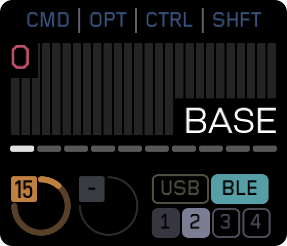
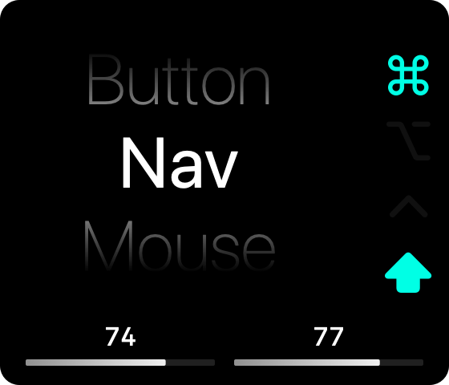
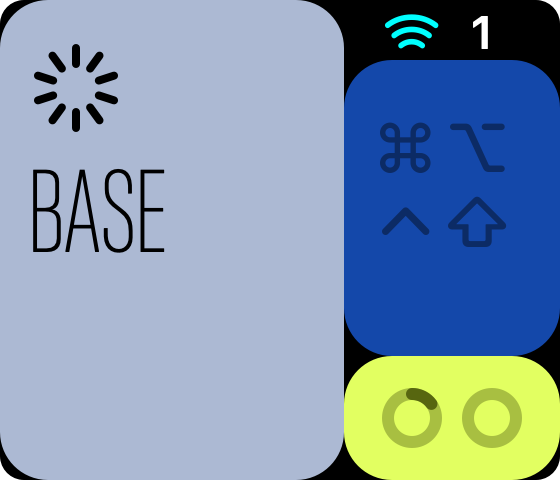
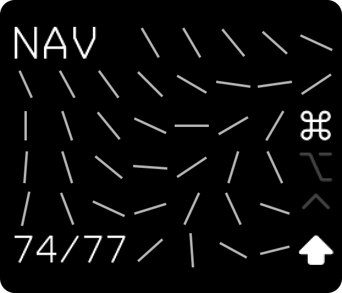
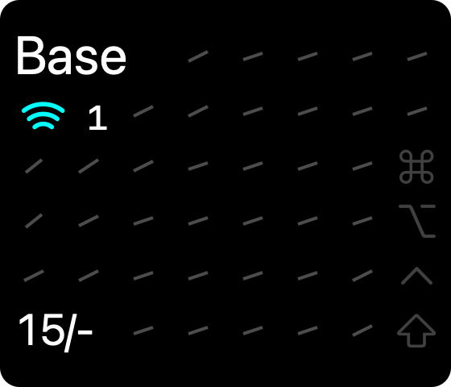
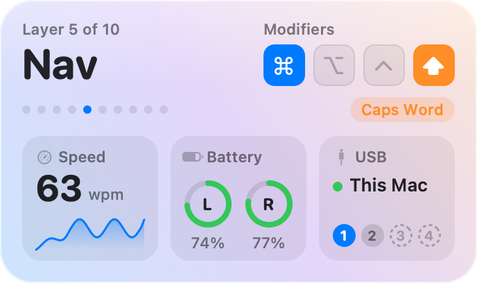
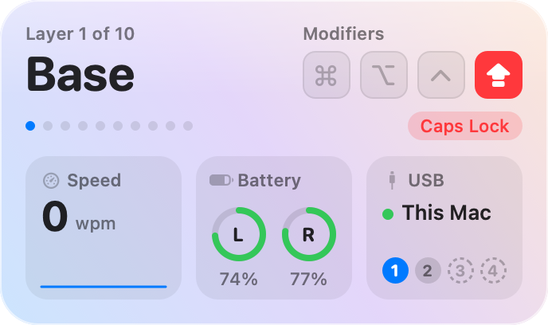
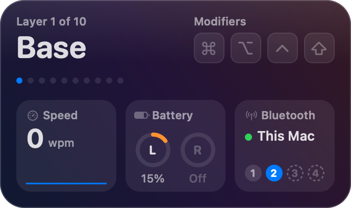

# KeyBeacon

**English** · [中文](README.zh-CN.md) · [**Website** ↗](https://ykiewang.github.io/keybeacon/)

**KeyBeacon** is built for **ZMK** keyboards — above all the screenless wireless splits (the Totem
among them) where there's no on-device way to see what the board is doing. It shows your keyboard's
live internal state — the **active layer**, **held modifiers**, connectivity, and per-half battery —
in a small desktop app, over Bluetooth LE. ZMK is the first-class target: add one entry to
`west.yml`, set one Kconfig symbol, done.

The underlying open **KeyBeacon Protocol (KBP)** is deliberately **not** ZMK-specific, so any
keyboard or firmware that speaks KBP can drive the same app — **ZMK is simply where it works today,
with the least setup**, and the protocol is designed to extend to any keyboard over time.

> **This fork** ([eg0n/keybeacon](https://github.com/eg0n/keybeacon), branch `feat/usb-hid`) adds:
> KBP over **USB**, for a keyboard or dongle plugged into the computer; **KBP 1.3** (WPM, layer
> count, Caps Word, Caps Lock, empty profiles, dongle topology, layer names); pluggable **status
> screens** for the macOS app, starting with the Prospector dongle's; and a **Linux** bar widget
> for [Omarchy](app/linux/omarchy/). Its firmware is
> [eg0n/zmk-keybeacon](https://github.com/eg0n/zmk-keybeacon/tree/feat/dongle-usb), branch
> `feat/dongle-usb`. See [KBP 1.3 and USB](#kbp-13-and-usb-this-fork).


## Why KeyBeacon

Many ZMK keyboards — the Totem among them — have **no screen**: you press a layer key with no
on-device way to confirm which layer is active. The usual fix is to bolt on hardware (an OLED,
wiring, firmware, cost). KeyBeacon does the opposite — the host your keyboard is already connected
to **has** a screen, so let the software show the state. **No extra hardware, no soldering.** It
starts with layer + modifiers and is built to grow into a general-purpose window into any
keyboard's internal state, over a versioned, extensible protocol.

## Supported ZMK configs

Ready-to-flash ZMK configs with KeyBeacon already wired in:

| Config | Keyboard | Notes |
|--------|----------|-------|
| [`zmk-config-totem`](https://github.com/ykiewang/zmk-config-totem#keybeacon-layer--modifier-status-over-ble) | Totem (38-key screenless split) | The reference integration — start here. |
| [`zmk-config-corne`](https://github.com/YkieWang/zmk-config-corne/tree/feat/keybeacon) | Corne (CRKBD) | Integration lives on the `feat/keybeacon` branch. |

Built KeyBeacon into your own board? **Contributions are welcome** — open an issue or PR on this
repo with your config, and we'll add it to the list.

## Quick start

Grab the latest build from the [**Releases**](https://github.com/ykiewang/keybeacon/releases) page, then:

### macOS

> **This fork**: build the app with `./packaging/make-app.sh` (see
> [Build from source](#build-from-source-optional)), or download the `BleWidget` artifact from
> this repository's CI. The steps below still apply.

1. Download `BleWidget-<version>.dmg`, open it, and drag **BleWidget.app** to `/Applications`.
2. **First launch:** the build is ad-hoc signed (not notarized), so right-click the app →
   **Open** → confirm once. *(One-time; a future notarized release removes this step.)*
3. Grant **Bluetooth** permission when asked. The app lives in the **menu bar** — connect a
   compatible keyboard and its live layer/modifier status appears.

### Windows

1. Download `KeyBeacon-win-x64-<version>.zip` (or `-win-arm64-`), unzip, and run `KeyBeacon.exe`.
   It's **self-contained** — no .NET install needed.
2. **First run:** SmartScreen may warn → **More info** → **Run anyway**. If the file is blocked,
   right-click it → **Properties** → tick **Unblock**.
3. The app lives in the **system tray** (the **K** icon, possibly under the `^` overflow). Left-click
   toggles the floating panel; right-click opens the menu.

> **Requirements:** macOS 12 (Monterey)+ or Windows 10 (build 19041 / 2004) / 11, plus a keyboard
> that implements KBP on its host-link BLE role (see [`conformance/`](conformance/)). Both apps are
> bilingual (中文 / English), switchable anytime from the app menu.

## Screenshots

The floating panel updates as you type. A **per-link host indicator** (new in KBP 1.2) tells
*this* computer whether the keyboard is typing here (green ●), active on another paired computer
(orange ◐), or disconnected from this host (grey ○).

<details>
<summary><b>More screenshots</b> — full states, compact mode, menu bar</summary>

### Full display mode

| In use on **this** computer | Active on **another** computer | Link to this host down |
|:---:|:---:|:---:|
|  |  |  |

### Compact display mode

The same state folded into one menu-bar-width strip — layer · modifiers · host · profile ·
per-half battery · output:

| Host state | |
|:---|:---|
| **In use here** — green `● P1` |  |
| **Active elsewhere** — orange `◐ P2` |  |
| **Link down** — grey `○ P4` |  |

### Prospector screens (this fork)

The [Prospector](https://github.com/carrefinho/prospector-zmk-module) dongle's status screens,
redrawn at their 280×240 size from KBP data: carrefinho's **Operator**, **Classic**, **Radii** and
**Field**, and the **Crystal** layout from [our fork](https://github.com/eg0n/prospector-zmk-module).
Choose one under **Display Mode**; with **On Desktop** the panel sits behind your windows like a
desktop widget. Text and icons use the firmware's own bitmap fonts, glyph for glyph.

#### Operator

| Typing, Caps Word on | Idle, Caps Lock on |
|:---:|:---:|
|  |  |
| **Right half offline, left at 15 %, BLE profile 2** | **Disconnected** |
|  |  |

- **Top**: held modifiers; SHFT turns amber for Caps Word and red for Caps Lock.
- **Meter**: words per minute in 26 bars, with a peak marker; the number top left, the layer name
  bottom right, and one segment per layer below.
- **Rings**: each half's battery, green, amber under 20 %, thin and grey while the half is offline.
- **Bottom right**: the output (USB or BLE) and the BLE profiles, the active one lit, empty ones as
  outlines.

#### Classic, Radii, Field and Crystal

| Typing, Caps Word on | Right half offline, left at 15 %, BLE profile 2 |
|:---:|:---:|
|  |  |
|  |  |
|  |  |
|  |  |

- **Classic**: a layer roller, the modifiers down the right, a battery bar per half (a red cross
  while offline).
- **Radii**: a layer wheel and name, the modifiers, and battery rings, in the module's blue theme.
- **Field**: a grid of lines that flow faster and brighter as you type and settle when you stop.
- **Crystal**: WPM, output, a modifier grid with Caps Word (green) and Caps Lock (magenta), the
  turning crystal, batteries and the layer.
- On Classic, Radii and Field the BLE profile (numbered from 0, as on the dongle) shows while BLE
  is the output and for 3 seconds after a change; Caps Lock, which the dongle doesn't show there,
  turns Shift into a red Caps Lock key.

### Glass widget (this fork)

The same data in macOS's own design language: SF Pro and SF Symbols, system colours, light or
dark with the system, on Liquid Glass (macOS 26 and later; a translucent material before). Choose
**Glass Widget** under **Display Mode**.

| Typing, Caps Word on (light) | Typing (dark) |
|:---:|:---:|
|  |  |
| **Caps Lock on (light)** | **Right half offline, BLE profile 2 (dark)** |
|  |  |

- **Top**: the layer, its place in the keymap and a dot per layer; a keycap per modifier, orange
  for Caps Word and red for Caps Lock, with a capsule naming which.
- **Speed**: words per minute and the last 40 seconds as a sparkline.
- **Battery**: a ring per half, orange at 20 % and red at 10 %, empty while the half is offline.
- **Output**: USB or Bluetooth, which computer it is typing to, and the BLE profiles (dashed when
  empty).

The previews show a stand-in for the glass, as offscreen renders can't capture it.

The renderings come from `swift run screen-preview` (see [Build from source](#build-from-source-optional)).
New screens are one file and a registry entry; [CLAUDE.md](CLAUDE.md) explains how.

### Menu bar

Reconnect, switch display mode (including status screens), or change language. The **Panel**
submenu (this fork) gathers the panel's settings: show or hide it; its layer, above windows or on
the desktop behind them; its position, anywhere or pinned to a corner; and a lock that lets clicks
pass through it:


</details>

## What's in this repo

| Directory | What |
|-----------|------|
| [`app/macos/`](app/macos/) | The macOS app (menu-bar widget + floating status panel). |
| [`app/linux/omarchy/`](app/linux/omarchy/) | (This fork) A Linux bar widget for Omarchy 4, over USB. |
| [`app/windows/`](app/windows/) | The Windows app (system tray + floating status panel). |
| [`protocol/`](protocol/) | The authoritative, versioned **KeyBeacon Protocol** (KBP) standard. |
| [`conformance/`](conformance/) | The **conformance kit** — guide + checklist + self-test tool for keyboard authors. |

> **Platforms:** macOS and Windows are available now; **Linux is planned** upstream, and this
> fork has an [Omarchy](app/linux/omarchy/) bar widget over USB. The protocol is OS-neutral by
> design.

## For keyboard authors

- **Running ZMK?** Don't implement KBP by hand — add the
  [`zmk-keybeacon`](https://github.com/ykiewang/zmk-keybeacon) Zephyr module to your
  `config/west.yml` and set `CONFIG_ZMK_KEYBEACON=y` on the central build. Two-step setup in its
  [GETTING-STARTED.md](https://github.com/ykiewang/zmk-keybeacon/blob/main/GETTING-STARTED.md).
- **Want a working example?** [`zmk-config-totem`](https://github.com/ykiewang/zmk-config-totem)
  wires KeyBeacon into a split keyboard end to end — flash it, or read it to see exactly how the
  module plugs in.
- **Other firmware, or from scratch?** Read [`protocol/README.md`](protocol/README.md) (the
  standard) and [`conformance/CONFORMANCE.md`](conformance/CONFORMANCE.md) (what to implement),
  then run the self-test: `python3 conformance/conformance_tool.py`.
- **Dongle, USB or KBP 1.3?** Use this fork's module,
  [eg0n/zmk-keybeacon `feat/dongle-usb`](https://github.com/eg0n/zmk-keybeacon/tree/feat/dongle-usb):
  `CONFIG_ZMK_KEYBEACON_SPLIT_DONGLE=y` for a dongle central, `CONFIG_ZMK_KEYBEACON_USB=y` with
  `CONFIG_USB_HID_DEVICE_COUNT=2` for USB, and `CONFIG_ZMK_WPM=y` / `CONFIG_ZMK_HID_INDICATORS=y`
  for WPM and Caps Lock. Its README has a complete dongle configuration.

## KBP 1.3 and USB (this fork)

KBP 1.3 adds optional pieces; older apps and keyboards ignore what they don't know. The normative
text is [`protocol/README.md` §16–17](protocol/README.md#16-kbp-13-activity-open-profiles-dongles-and-usb-optional).

- **Activity characteristic** `AA440AA5-…` (`READ` + `NOTIFY`): `[wpm, layer_count, flags]`.
  `wpm` is 255 when the keyboard computes none; `flags` bit 0 is Caps Word, bit 1 the host's Caps
  Lock LED. Screens use the layer count to draw one mark per layer.
- **Empty profiles**: Connectivity (`AA2`) grows an eighth byte, `open_profiles`, a bit per BLE
  profile with no bonded host.
- **Dongles**: when both halves are peripherals of a dongle, `split_link_flags` bit 0 and Battery
  `[0]` are the left half's and bit 1 and `[1]` the right half's.
- **USB HID**: the same payloads on a vendor-defined HID interface (usage page `0xFFAA`, usage
  `0x44`). Report IDs 1–4 are AA1, AA2, AA3 and AA5; each report body is `[length, payload…]`.
  Input reports arrive on change, feature reports are reads. The apps prefer USB while the
  keyboard is plugged in, so a dongle on USB needs no Bluetooth link, and on macOS no Input
  Monitoring permission.
- **Layer names**: the **Layer Name** characteristic `AA440AA6-…` (`READ` + `WRITE`): write a
  layer index, read `[layer_index, layer_count, layer_name]`. On USB it is feature report 5
  (Set_Report selects, Get_Report reads). The apps look up every layer when they connect.
- **Encryption**: producers require an encrypted link for every KBP characteristic, so only a
  bonded host can read the keyboard's state.

On ZMK, the fork of `zmk-keybeacon` implements all of it (see [For keyboard authors](#for-keyboard-authors)).

## Roadmap

Candidate metrics for a screenless split keyboard — connectivity & power (shipped in KBP 1.1 / 1.2),
input & lock state (Caps Word and Caps Lock shipped in this fork's KBP 1.3), typing stats (WPM
likewise), and device health. See [**docs/ROADMAP.md**](docs/ROADMAP.md).

## Build from source (optional)

```bash
cd app/macos
swift build -c release        # or: swift run BleWidget
swift test                    # pure-logic unit tests (needs Xcode, not just the Command Line Tools)
swift run screen-preview /tmp # renders every status screen in sample states to PNGs
```

Package a distributable bundle: `./packaging/make-app.sh 0.0.0-dev` →
`dist/BleWidget.app`, `.dmg`, `.zip`, `.sha256`.

## License

MIT — see [LICENSE](LICENSE). The protocol is permissively licensed so any keyboard or app may
implement it.
