# KeyBeacon

[English](README.md) · **中文** · [**网站** ↗](https://ykiewang.github.io/keybeacon/)

**KeyBeacon** 为 **ZMK** 键盘而做 —— 尤其是没有屏幕的无线分体键盘（比如 Totem），它们在键盘
本体上根本无法一眼看清当前状态。它在桌面小应用里，通过蓝牙 LE 实时显示键盘的内部状态：**当前层**、
**按住的修饰键**、连接状态与左右半电量。ZMK 是首选目标：在 `west.yml` 加一条、再打开一个 Kconfig
符号即可接入。

而底层开放的 **KeyBeacon 协议（KBP）** 刻意**不绑定** ZMK —— 任何实现 KBP 的键盘或固件都能驱动
同一个应用。**ZMK 只是目前开箱即用、接入成本最低的那一个**，协议在设计上会逐步扩展到任意键盘。

> **本分支**([eg0n/keybeacon](https://github.com/eg0n/keybeacon),分支 `feat/usb-hid`)新增:经
> **USB** 传输 KBP(键盘或接收器插在电脑上时);**KBP 1.3**(WPM、层数、Caps Word、Caps Lock、空
> profile、接收器拓扑、层名);macOS 应用的可插拔**状态屏**,首批为 Prospector 接收器的各屏;以及
> [Omarchy](app/linux/omarchy/) 的 **Linux** 状态栏小组件。固件见
> [eg0n/zmk-keybeacon](https://github.com/eg0n/zmk-keybeacon/tree/feat/dongle-usb) 分支
> `feat/dongle-usb`。详见下方「KBP 1.3 与 USB」。


## 为什么是 KeyBeacon

很多 ZMK 键盘 —— 比如 Totem —— **没有屏幕**:你按下层切换键,却无法在键盘本体上确认当前在哪一层。
常见解法是外挂硬件(一块 OLED、走线、固件、成本)。KeyBeacon 反其道而行 —— 你的键盘本就连着的
那台电脑**有**屏幕,那就用软件来显示状态。**不需要额外硬件、不需要焊接。** 它从"层 + 修饰键"
起步,并被设计为逐步成长为一个通用的键盘内部状态窗口,建立在带版本、可扩展的协议之上。

## 支持的 ZMK 配置

已经接入 KeyBeacon、可直接刷入的 ZMK 配置：

| 配置 | 键盘 | 说明 |
|------|------|------|
| [`zmk-config-totem`](https://github.com/ykiewang/zmk-config-totem#keybeacon-layer--modifier-status-over-ble) | Totem（38 键无屏分体） | 参考实现 —— 建议从这里开始。 |
| [`zmk-config-corne`](https://github.com/YkieWang/zmk-config-corne/tree/feat/keybeacon) | Corne（CRKBD） | 集成在 `feat/keybeacon` 分支上。 |

你的板子也接好了 KeyBeacon？**欢迎提交** —— 在本仓库开 issue 或 PR 附上你的配置，我们把它加进列表。

## 快速上手

从 [**Releases**](https://github.com/ykiewang/keybeacon/releases) 页面下载最新构建,然后:

### macOS

> **本分支**:用 `./packaging/make-app.sh` 构建(见「从源码构建」),或从本仓库 CI 下载 `BleWidget`
> 产物。以下步骤同样适用。

1. 下载 `BleWidget-<版本>.dmg`,打开后把 **BleWidget.app** 拖到「应用程序」。
2. **首次启动:** 当前构建为 ad-hoc 签名(未公证),右键点应用 → **打开** → 确认一次即可。
   *(仅首次;将来的公证版本会移除这一步。)*
3. 按提示授予**蓝牙**权限。应用常驻**菜单栏** —— 连接一把兼容键盘,其实时的层/修饰键状态即会显示。

### Windows

1. 下载 `KeyBeacon-win-x64-<版本>.zip`(ARM64 机器选 `-win-arm64-`),解压后运行 `KeyBeacon.exe`。
   该构建为**自包含单文件** —— 无需安装 .NET。
2. **首次运行:** SmartScreen 可能告警 → **更多信息** → **仍要运行**。若文件被阻止,右键 →
   **属性** → 勾选**解除锁定**。
3. 应用常驻**系统托盘**(**K** 图标,可能收在 `^` 溢出箭头里)。左键切换悬浮面板,右键打开菜单。

> **环境要求:** macOS 12(Monterey)或更高,或 Windows 10(build 19041 / 2004)/ 11;以及一把在其
> 宿主链路(central)BLE 角色上实现了 KBP 的键盘(见 [`conformance/`](conformance/))。两个客户端
> 均支持双语(中文 / English),可随时在应用菜单切换。

## 界面预览

悬浮面板随你打字实时更新。其中的**每连接主机指示**(KBP 1.2 新增)会告诉*这台*电脑:键盘正在此
打字(绿 ●)、在另一台已配对电脑上活跃(橙 ◐),还是与本机已断开(灰 ○)。

<details>
<summary><b>更多截图</b> —— 完整模式各状态、精简模式、菜单栏</summary>

### 完整模式

| 正在**此**电脑使用 | 在**另一台**电脑使用 | 与本机链路断开 |
|:---:|:---:|:---:|
|  |  |  |

### 精简模式

同一状态折叠进一条菜单栏宽度的横条 —— 层 · 修饰键 · 主机 · profile · 左右半电量 · 输出:

| 主机状态 | |
|:---|:---|
| **本机在用** — 绿 `● P1` |  |
| **他机在用** — 橙 `◐ P2` |  |
| **链路断开** — 灰 `○ P4` |  |

### Prospector 屏(本分支)

[Prospector](https://github.com/carrefinho/prospector-zmk-module) 接收器的状态屏,按其 280×240 尺寸用
KBP 数据重绘:carrefinho 的 **Operator**、**Classic**、**Radii**、**Field**,以及
[本分支固件](https://github.com/eg0n/prospector-zmk-module)的 **Crystal**。在**显示模式**中选择;勾选**置于桌面**后面板位于所有窗口之下,像桌面小组件。文字与图标使用固件自带的位图字体,逐字形一致。

#### Operator

| 打字中,Caps Word 开 | 空闲,Caps Lock 开 |
|:---:|:---:|
| 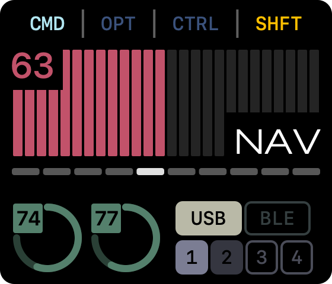 | 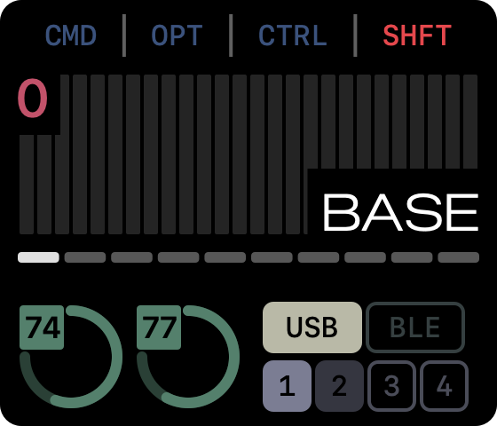 |
| **右半离线,左半 15%,BLE profile 2** | **未连接** |
| 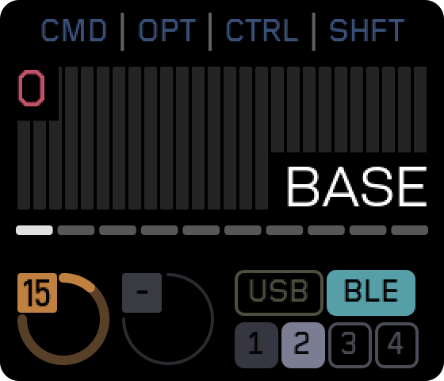 | 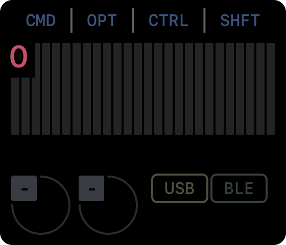 |

- **顶部**:按住的修饰键;Caps Word 时 SHFT 变琥珀色,Caps Lock 时变红色。
- **条形表**:26 格显示每分钟字数,带峰值标记;左上为数字,右下为层名,下方每层一段。
- **圆环**:每半的电量,绿色,低于 20% 为琥珀色,离线时变细变灰。
- **右下**:输出(USB 或 BLE)与 BLE profile,当前的点亮,空的只画轮廓。

#### Classic、Radii、Field 与 Crystal

| 打字中,Caps Word 开 | 右半离线,左半 15%,BLE profile 2 |
|:---:|:---:|
| 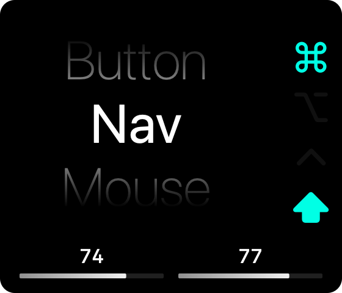 | 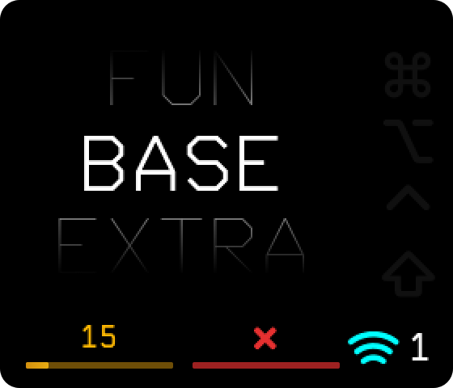 |
| 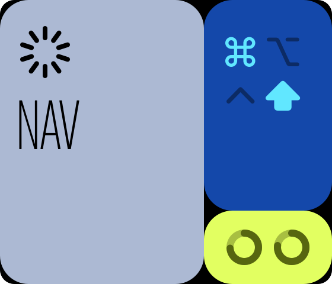 | 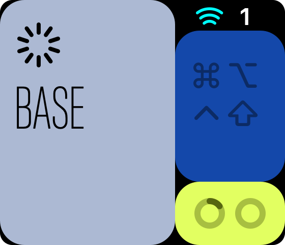 |
| 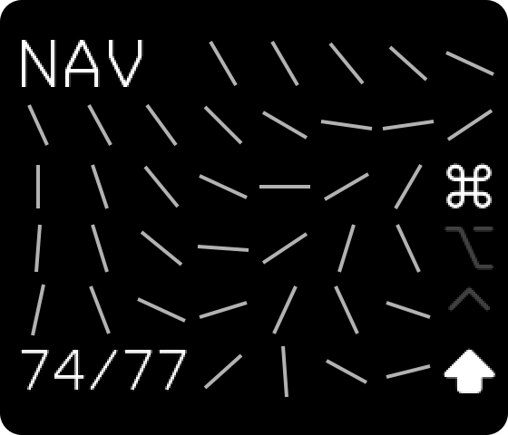 | 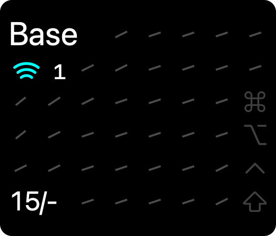 |
| 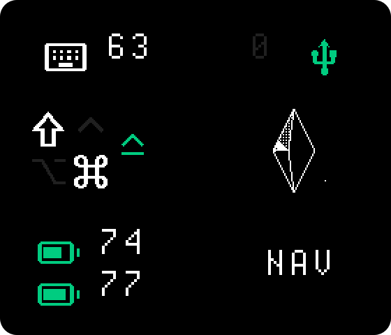 | 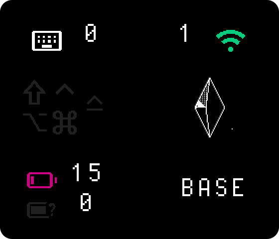 |

- **Classic**:层滚轮、右侧一列修饰键、每半一条电量条(离线时为红叉)。
- **Radii**:层转盘与层名、修饰键、电量圆环,采用模块的蓝色主题。
- **Field**:一格格短线,打字越快流动越快越亮,停下后慢慢平复。
- **Crystal**:WPM、输出、修饰键网格(Caps Word 绿、Caps Lock 品红)、旋转的水晶、电量与层名。
- Classic、Radii、Field 上,BLE 为输出时以及切换后 3 秒内显示 BLE profile(与接收器一致,从 0 编号);接收器在这几屏不显示 Caps Lock,这里把 Shift 换成红色的 Caps Lock 键。

### Glass 小组件(本分支)

同样的数据,采用 macOS 自身的设计语言:SF Pro 与 SF Symbols、系统配色,随系统浅色/深色切换,底层为 Liquid Glass(macOS 26 及以后;更早版本为半透明材质)。在**显示模式**中选择 **Glass Widget**。

| 打字中,Caps Word 开(浅色) | 打字中(深色) |
|:---:|:---:|
| 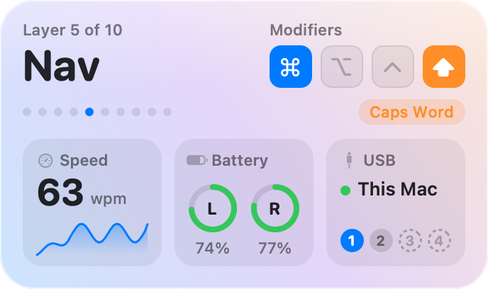 | 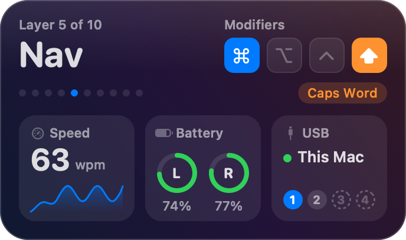 |
| **Caps Lock 开(浅色)** | **右半离线,BLE profile 2(深色)** |
| 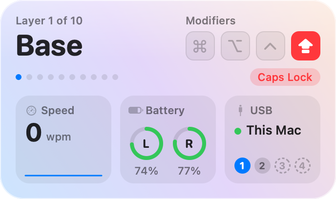 | 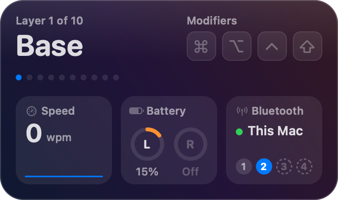 |

- **顶部**:当前层、它在键位图中的位置与每层一个圆点;每个修饰键一个键帽,Caps Word 为橙色、Caps Lock 为红色,并以胶囊标注。
- **速度**:每分钟字数,以及最近 40 秒的走势线。
- **电量**:每半一个圆环,20% 及以下为橙色、10% 为红色,离线时为空环。
- **输出**:USB 或蓝牙、正在向哪台电脑输入,以及 BLE profile(空的为虚线)。

预览图中的玻璃为模拟效果,离屏渲染无法捕获真实的玻璃材质。

渲染图由 `swift run screen-preview` 生成。新增一个状态屏只需一个文件加一行注册;做法见 [CLAUDE.md](CLAUDE.md)。

### 菜单栏

重新连接、切换显示模式(含状态屏)、切换语言。**浮窗**子菜单(本分支)集中了浮窗设置:显示或隐藏;层级,浮于窗口之上或置于桌面(窗口之下);位置,任意或钉到屏角;以及让点击穿透的锁定:


</details>

## 本仓库包含什么

| 目录 | 内容 |
|------|------|
| [`app/macos/`](app/macos/) | macOS 应用(菜单栏小组件 + 悬浮状态面板)。 |
| [`app/linux/omarchy/`](app/linux/omarchy/) | (本分支)Omarchy 4 的 Linux 状态栏小组件,经 USB。 |
| [`app/windows/`](app/windows/) | Windows 应用(系统托盘 + 悬浮状态面板)。 |
| [`protocol/`](protocol/) | 权威、带版本的 **KeyBeacon 协议**(KBP)标准。 |
| [`conformance/`](conformance/) | **一致性套件** —— 面向键盘作者的指南 + 清单 + 自测工具。 |

> **平台:** macOS 与 Windows 现已可用;上游 **Linux 已在计划中**,本分支已有经 USB 的
> [Omarchy](app/linux/omarchy/) 状态栏小组件。协议在设计上与操作系统无关。

## 面向键盘作者

- **用的是 ZMK?** 无需手写实现 KBP —— 把
  [`zmk-keybeacon`](https://github.com/ykiewang/zmk-keybeacon) Zephyr 模块加入 `config/west.yml`,
  并在 central 构建上设置 `CONFIG_ZMK_KEYBEACON=y`。两步接入详见其
  [GETTING-STARTED.md](https://github.com/ykiewang/zmk-keybeacon/blob/main/GETTING-STARTED.md)。
- **想要可直接运行的示例?** [`zmk-config-totem`](https://github.com/ykiewang/zmk-config-totem)
  把 KeyBeacon 完整接入了一把分体键盘 —— 刷进去即可,或直接阅读它、看模块究竟怎么接入。
- **其他固件,或从零实现?** 阅读 [`protocol/README.md`](protocol/README.md)(标准)与
  [`conformance/CONFORMANCE.md`](conformance/CONFORMANCE.md)(需要实现什么),然后运行自测:
  `python3 conformance/conformance_tool.py`。
- **接收器、USB 或 KBP 1.3?** 使用本分支的模块
  [eg0n/zmk-keybeacon `feat/dongle-usb`](https://github.com/eg0n/zmk-keybeacon/tree/feat/dongle-usb):
  接收器 central 设 `CONFIG_ZMK_KEYBEACON_SPLIT_DONGLE=y`,USB 设 `CONFIG_ZMK_KEYBEACON_USB=y` 并加
  `CONFIG_USB_HID_DEVICE_COUNT=2`,WPM 与 Caps Lock 分别需要 `CONFIG_ZMK_WPM=y` /
  `CONFIG_ZMK_HID_INDICATORS=y`。模块 README 中有完整的接收器配置。

## KBP 1.3 与 USB(本分支)

KBP 1.3 新增若干可选内容;旧版应用与键盘会忽略不认识的部分。规范文本见
[`protocol/README.md` §16–17](protocol/README.md)。

- **Activity 特征** `AA440AA5-…`(`READ` + `NOTIFY`):`[wpm, layer_count, flags]`。键盘不计算 WPM
  时 `wpm` 为 255;`flags` bit 0 为 Caps Word,bit 1 为主机的 Caps Lock 灯。状态屏用层数为每层画一个标记。
- **空 profile**:Connectivity(`AA2`)新增第 8 字节 `open_profiles`,每个未绑定主机的 BLE profile 一位。
- **接收器**:两半都是接收器的 peripheral 时,`split_link_flags` bit 0 与 Battery `[0]` 属于左半,bit 1
  与 `[1]` 属于右半。
- **USB HID**:相同载荷位于厂商自定义 HID 接口(usage page `0xFFAA`,usage `0x44`)。Report ID 1–4
  对应 AA1、AA2、AA3、AA5;每个 report 主体为 `[length, 载荷…]`。变化时发 input report,读取用 feature
  report。键盘插着时应用优先用 USB,因此插在 USB 上的接收器无需蓝牙链路,在 macOS 上也无需"输入监控"权限。
- **层名**:**Layer Name** 特征 `AA440AA6-…`(`READ` + `WRITE`):写入层索引,读取
  `[layer_index, layer_count, layer_name]`。USB 上为 feature report 5(Set_Report 选择,Get_Report 读取)。
  应用连接后逐层查询。
- **加密**:生产者要求每个 KBP 特征都使用加密链路,只有已绑定的主机能读取键盘状态。

ZMK 上由本分支的 `zmk-keybeacon` 实现全部内容(见「面向键盘作者」)。

## 路线图

面向无屏分体键盘的候选指标 —— 连接与电量(已随 KBP 1.1 / 1.2 发布)、输入与锁定状态、打字统计、
设备健康。见 [**docs/ROADMAP.md**](docs/ROADMAP.md#zh-roadmap)。

## 从源码构建(可选)

```bash
cd app/macos
swift build -c release        # 或:swift run BleWidget
swift test                    # 纯逻辑单元测试(需要 Xcode,仅有 Command Line Tools 不够)
swift run screen-preview /tmp # 把每个状态屏的示例状态渲染为 PNG
```

本地打包可分发产物:`./packaging/make-app.sh 0.0.0-dev` →
`dist/BleWidget.app`、`.dmg`、`.zip`、`.sha256`。

## 许可

MIT —— 见 [LICENSE](LICENSE)。协议特意采用宽松许可,任何键盘或应用都可实现。
